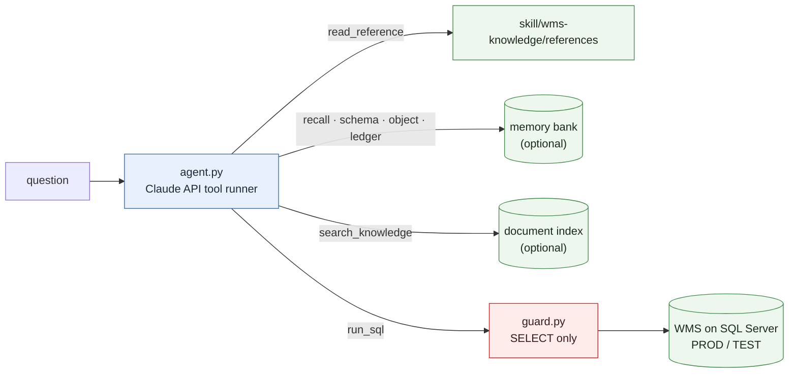

# wms-assistant

Turn a general AI assistant into a specialist for one WMS, without training a model. Two layers, both portable:

1. **A domain-knowledge skill** (`skill/wms-knowledge/`): the decoded facts about a Körber/HighJump Advantage-style WMS that are *not* derivable from the schema - status codes, dead columns, the ERP integration contract, allocation and wave-automation behaviour, receiving and RF pathologies, production cleanup recipes, design-database compiler rules, and a customization inventory. A router file loads one reference at a time, so a cheap question stays cheap.
2. **A standalone agent** (`agent/`): the same specialist outside Claude Code, on the Claude API. SDK tool runner, streaming, one-hour prompt cache on the fixed context, eight read-only tools (reference files, memory bank, schema, procedure bodies, write ledger, document search, SQL), transcripts, per-turn cost. Read-only by construction: the SQL gate accepts a single `SELECT` and nothing else.

Plus `claude/CLAUDE.md.example`: the operating rules and the one-screen cheat sheet that every Claude Code session loads.

## Why not fine-tune

A WMS changes under you: procedures are patched, switches flip, a platform upgrade restores the design database. Facts baked into model weights go stale silently; facts in files carry a verified date and can be re-checked live. Context (what the model knows at start), tools (what it can look up) and memory (what it keeps between sessions) give the same specialisation and stay current. The memory layers this agent reads are described in [ai-ops-playbook/04-memory-architecture.md](../ai-ops-playbook/04-memory-architecture.md).

## What is in here

| Path | What it is |
|---|---|
| `skill/wms-knowledge/SKILL.md` | the router: when to load which reference, plus the ten facts that prevent the most wrong answers |
| `skill/wms-knowledge/references/01..08-*.md` | environment and codes; schema gotchas; ERP integration; allocation, waves and automation; receiving, inventory and RF; cleanup recipes; design-database development; customization inventory |
| `claude/CLAUDE.md.example` | operating rules (confirm before any production write, NOLOCK, cache-first lookup) and the cheat sheet |
| `agent/` | the Claude API agent, its read-only guard, tools, smoke test and README |

## Sanitized reference

Hosts, database names, warehouse codes, custom object and switch names, companies, people, dates and counts have been removed or replaced with placeholders such as `<PROD_HOST>` and `<SWITCH>`. Table, column and procedure names shown are vendor-standard. Where a reference says "verified", the verification was against a live production instance of the platform; re-verify against yours.
