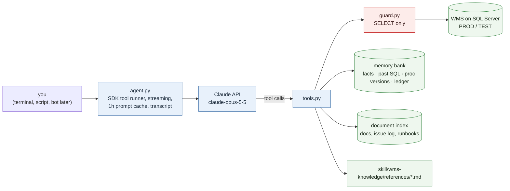

# agent: the same assistant, outside Claude Code

A small Python program that gives a team the specialised WMS assistant without Claude Code: the `wms-knowledge` skill and cheat sheet as its standing context, an optional memory bank and document index as cached lookups, and **read-only** SQL against production and test. It runs from a terminal, from a script, from a scheduled job, and later behind a chat bot.



## Run it

```powershell
cd agent
python -m pip install -r requirements.txt        # anthropic >= 1.13, pyodbc
copy .env.example .env                           # key, SQL login, hosts
python smoke_test.py                             # guard + every registered tool, no API call
python agent.py --dry-run                        # system prompt size, tools, servers
python agent.py --ask "Which allocation profile do transfer orders use, and what does the LEFO gate change?"
python agent.py                                  # interactive; 'quit' to leave
```

Options: `--server test` (default server for queries), `--model`, `--effort low|medium|high|xhigh|max`, `--quiet` (final answer only). Every turn is appended to `transcripts/<date>.jsonl` (question, tool calls, answer, token usage, cost); keep that folder out of git.

## How it is built

| Piece | What it does |
|---|---|
| `config.py` | env-driven: server registry, model/effort/row caps, optional paths to the skill, a CLAUDE.md, a memory bank and a document index; the price table |
| `guard.py` | the read-only gate: one statement, must start with SELECT/WITH, no write/DDL/EXEC/system-proc words, no SELECT INTO. No write mode exists |
| `tools.py` | `@beta_tool` functions. SQL goes through the guard, runs READ UNCOMMITTED with a timeout and a row cap, and is recorded in the memory bank when one is configured. Memory tools call the memory bank's own MCP-server functions directly; document search imports the knowledge server; `read_reference` serves the skill's reference files. Tools whose backing folder is absent are simply not registered |
| `agent.py` | builds the system prompt (operating rules + SKILL.md + the CLAUDE.md cheat sheet, one block cached for 1 h), runs `client.beta.messages.tool_runner(stream=True, ...)`, prints text as it streams and tool names as they fire, mirrors the history for multi-turn, prints usage and an estimated cost per turn |
| `smoke_test.py` | proves the guard and every registered tool without spending a token |

Model settings follow the current API: `claude-opus-5-5`, adaptive thinking, `output_config.effort=high` (the model's own default is medium), `eager_input_streaming` on every tool because the request streams, and the server-side refusal fallback (`fallbacks="default"` under beta `server-side-fallback-2026-07-01`) so a safety decline re-runs on a fallback model instead of returning nothing. Set `WMS_AGENT_FALLBACKS=0` to turn that off. Forced `tool_choice` is not used (Opus 5.5 rejects it); the system prompt states the lookup order instead.

## What Claude gets, and when

- **Always** (cached, a few thousand tokens): the operating rules, the ten headline WMS facts and the routing table from `SKILL.md`, the cheat sheet.
- **On demand**: `read_reference("03")` loads one reference file when the question needs it. A cheap question stays cheap; a deep question is well-grounded.
- **From the caches** (when configured): `recall`, `schema`, `find_column`, `object_definition`, `recent_changes` read the memory bank; `search_knowledge` reads the document index.
- **Live**: `run_sql`, read-only. The prompt tells Claude to verify current state live and to say which query it ran.

## Safety

- Nothing in this program can write to a database. The guard is the control, so keep it strict; a `db_owner` login still cannot write through it. For a shared deployment use a read-only SQL login.
- Questions and tool results go to the Claude API. Keep personal data, credentials and secrets out of questions and out of the data you ask it to show. Transcripts contain row samples and SQL; keep them local.

## Cost

With the 1-hour cache the fixed context costs a few cents to write once and a fraction of a cent per later turn to read; a typical question with three tool calls and a short answer lands at a few cents on Opus 5.5. The per-turn line printed after each answer is the exact usage. `--model claude-sonnet-5-5` halves it; `--effort medium` trims thinking on routine questions.

## Next steps

1. **Eval set**: 20-30 real questions with known-correct answers, scored by re-running `--ask --quiet` and diffing. Without it, prompt or model changes cannot be judged.
2. **Chat bot**: a Slack Bolt app that calls `Session.ask()` per thread and posts the answer; one `Session` per thread keeps the conversation. The read-only guard means it can be opened to supervisors.
3. **Scheduled reports**: `python agent.py --ask "<morning check>" --quiet` from a scheduler, posted to Slack.
